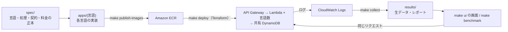

# Lambda Runtime Lab: 言語ごとの AWS Lambda 比較

同じ API を Python・Rust・TypeScript・Java で実装し、AWS Lambda のコンテナイメージとして同じ条件でデプロイして、処理時間・コールドスタート・メモリ・料金を比べる検証環境です。
「どの言語が常に優れているか」は前提にしません。作りたい API に近い処理（ワークロード）ごとに、実測で判断できるようにします。

## できること

| やりたいこと | 方法 |
| --- | --- |
| 言語ごとの処理時間・コールドスタート・メモリ・料金を比べる | `make ui` の画面で計測し、結果を見る |
| これから作る API の月額料金を言語ごとに見積もる | 画面の「作りたいAPIの月額料金を見込む」 |
| 結果をファイルで残す・表計算で扱う | `results/reports/<計測ID>.md`・`.csv` |
| 言語や計測する処理を増やす | `spec/` の一覧に足し、実装を追加する |

## 比べる対象

| 言語 | 主なフレームワーク・ライブラリ | ランタイム |
| --- | --- | --- |
| Python | FastAPI、Pydantic、Mangum | CPython 3.13 |
| Rust | Axum、Tokio、Serde、lambda_http | Rust 1.98（リリースバイナリ） |
| TypeScript | Hono、AWS SDK for JavaScript v3 | Node.js 24 |
| Java | Spring Boot 4、aws-serverless-java-container | Java 25 |

比較の原則は **WHAT は同じ、HOW は各言語で自然に** です。

- **そろえるもの**: API 契約（`spec/openapi.yaml`）、要求と期待応答（`spec/testcases/`）、エラー形式、DynamoDB の読み取り回数とデータ、Lambda の設定（arm64・メモリ・タイムアウト・ログ）、最終イメージの OS ベース（AL2023 OS-only）、計測条件。
- **各言語に任せるもの**: フレームワーク、並行処理、検証・シリアライズの方法、内部の構造。

全言語の応答が正本と一致することは、Contract Test（`make contract-test`）で状態コードと JSON の内容まで照合します。

## 仕組み



構成の詳細（AWS 構成図、手元の資材、コマンドごとに何が起きるか）は [全体構成と操作の地図](docs/10_全体構成と操作の地図.md) にまとめています。

## はじめかた

### 必要なもの

Docker（Buildx）、uv と Python 3.13、Rust（stable）、Node.js 24、Terraform、AWS CLI。Java は Maven がなければ Docker で実行します。

### 手元だけで確かめる（AWS 不要）

```bash
make lint            # 書式と静的解析
make test            # 全言語・計測ツールの単体テスト
make contract-test   # 全言語のイメージを起動し、応答を正本と照合
```

### AWS に環境を作って計測する

```bash
cp .env.example .env          # 初回だけ。AWS_PROFILE などを書く
make bootstrap-ecr            # ECR を作る（初回・言語追加時）
make publish-images           # 全言語をビルドして ECR へ登録（Lambda はまだ変わらない）
terraform -chdir=infrastructure/terraform plan \
  -var="aws_region=ap-northeast-1" -var="environment=benchmark"   # 変更予定の確認
make deploy                   # Lambda・API Gateway・DynamoDB などを作成・更新
# terraform output -raw dynamodb_table_name の値を .env の DYNAMODB_TABLE_NAME へ
source ./.env.export.sh
make seed                     # 比較用のデータを投入
make ui                       # http://127.0.0.1:8765/ で計測・比較
```

AWS の操作は料金が発生します。使い終わったら `make destroy` で削除します（ECR のイメージと DynamoDB のデータも消えます）。
詳しい手順・確認・切り戻しは [AWSデプロイ手順](docs/06_AWSデプロイ手順.md) を参照してください。

## 画面

`make ui` で開く画面では、次の3つを行えます。操作は [画面の操作ガイド](docs/09_画面の操作ガイド.md) を参照してください。

| 画面 | できること |
| --- | --- |
| 計測結果 | 指標ごとに一番有利な言語、全言語の比較表、P50・P95・P99 のグラフ、計測件数、実験条件 |
| 新しく計測する | ワークロード・言語・回数を選んで計測し、ログ収集とレポート作成まで自動で行う |
| 作りたいAPIの月額料金を見込む | 作りたい API がどの処理に近いかの割合と月間リクエスト数から、言語ごとの月額を見積もる |

計測を始める前に、デプロイ済みイメージの版と手元のアプリを照合します。デプロイ後にアプリのコード・依存定義・`Dockerfile` を変えていれば、計測を止めて再デプロイを促します（テストだけの変更では止めません）。

## API とワークロード

すべての言語が、1つの Lambda 関数から同じ5つのルートを公開します（Lambdalith: 複数のルートを1つの関数にまとめた小さな API）。

| ルート | 測るもの | ワークロード |
| --- | --- | --- |
| `GET /health` | フレームワークとランタイムの最小の負荷 | `health` |
| `POST /transform` | JSON の解析・検証・正規化・並べ替え | `transform-small`、`transform-large` |
| `POST /compute` | CPU を使う決定的なハッシュ計算 | `compute-sequential` |
| `GET /items/{id}` | DynamoDB から1件読む | `items` |
| `POST /aggregate` | DynamoDB から5件を順番に、または同時に読んで集計する | `aggregate-sequential`、`aggregate-concurrent` |

ワークロードの回数・同時実行数・ウォームアップは `spec/workloads.yaml` で定義します。一部の言語だけが対応するワークロードも定義でき、未対応の言語は計測せず「未対応」と表示します。

## 計測する指標と料金

| 指標 | 出どころ |
| --- | --- |
| 応答時間（P50・P95・P99） | 手元の計測ランナー |
| Lambda の実行時間・課金対象時間・初期化時間・最大メモリ | CloudWatch Logs の実行レポート |
| コールド・ウォームの件数、エラー率、ログと結び付かなかった件数 | 上記の結合結果 |
| 料金（100万リクエストあたり、うち実行時間分） | 課金対象時間・メモリ・`spec/pricing.yaml` |
| イメージの容量・レイヤー・digest | `scripts/collect-image-metrics.sh`（任意） |

```text
実行時間分の料金 = 課金対象時間（秒）× メモリ（GB）× GB秒あたりの料金
1リクエストの料金 = 実行時間分の料金 + リクエスト料金
```

料金は Lambda だけの概算です。Free Tier・API Gateway・DynamoDB・データ転送は含みません。料金表は `spec/pricing.yaml` の更新日と出典を確認してから使います。
取得できなかった値は 0 にせず「未取得」（`null`）のまま扱います。コンテナイメージの容量はデプロイ成果物の大きさで、実行料金とは別です。

## 主なコマンド

| 目的 | コマンド |
| --- | --- |
| 品質確認 | `make format`・`make lint`・`make test`・`make contract-test`・`make terraform-validate` |
| ビルド | `make build`（`IMPLEMENTATIONS="python rust"` で絞る） |
| AWS の構築・更新 | `make bootstrap-ecr`・`make publish-images`・`make deploy`・`make destroy` |
| データと計測 | `make seed`・`WORKLOAD=health make benchmark`・`RUN_ID=<計測ID> make collect`・`RUN_ID=<計測ID> make report`・`make benchmark-matrix` |
| 画面 | `make ui`（`UI_PORT=9000` でポートを変更） |

コマンドごとの読み書きと AWS への影響は [全体構成と操作の地図](docs/10_全体構成と操作の地図.md#4-操作の地図コマンドごとに何が起きるか) にあります。

## CI

- `.github/workflows/ci.yml`: push とプルリクエストで、全言語の書式・テスト、arm64 のイメージビルドと Contract Test、Terraform の検証を行います。AWS にはデプロイしません。
- `.github/workflows/benchmark.yml`: 手動実行だけです。GitHub OIDC で AWS のロールを引き受け、デプロイ・計測・レポート・削除を行います。

## 資料

| 資料 | 内容 |
| --- | --- |
| [画面の操作ガイド](docs/09_画面の操作ガイド.md) | 画面の見方・操作・困ったとき |
| [全体構成と操作の地図](docs/10_全体構成と操作の地図.md) | AWS 構成、手元の資材、コマンドごとの影響、目的別の手順 |
| [AWSデプロイ手順](docs/06_AWSデプロイ手順.md) | 初回構築・更新・確認・切り戻し・削除 |
| [ワークロードと言語の追加手順](docs/08_ワークロードと言語の追加手順.md) | 計測する処理や言語を増やす |
| [ベンチマークレポート利用ガイド](docs/07_BENCHMARK_REPORT_GUIDE.md) | Markdown・CSV レポートの読み方と注意点 |
| [要件](docs/01_REQUIREMENTS.md)・[仕様](docs/02_SPECIFICATION.md) | 比較方針・API 契約・計測仕様の正本 |

`docs/03`〜`05`、`docs/reviews/`、`docs/diagrams/aws-runtime-architecture.drawio` は、Python と Rust の2言語だった時点の記録です。現在の構成は上の資料を参照してください。

## 結果の扱い

計測結果は `results/` に保存し、画面とレポートで確認します。数値は条件（ワークロード・メモリ・回数・時間帯・手元の回線）で変わるため、README には載せません。
比較に使う前に、レポートの `Unclassified` が 0 であること、条件が同じであること、エラー率を確認してください。

結果はワークロードごとに解釈します。

- `/health` はフレームワークとランタイムの負荷として、アプリの処理と分けて読みます。
- I/O を伴う処理（DynamoDB）は、ネットワークの時間で言語差が小さくなることがあります。
- コールドスタートは初期化時間とイメージ・ランタイムの初期化を分けて比べます。
- 技術選定には、ビルド・依存・可観測性・保守性も含めて判断します。

## 制約

- コールドスタートを完全に同じ条件にはできません。初期化時間でコールドの計測を見分けますが、実行環境の入れ替わりは制御しきれません。
- ウォームの結果も、AWS 側の共有基盤・ネットワーク・スロットリングの影響を受けます。
- API Gateway、DynamoDB、CloudWatch への反映、手元の回線は、言語以外の時間として応答時間に含まれます。
- 比較の範囲は arm64・コンテナイメージ・1リージョンです。x86_64、ZIP デプロイ、Java の SnapStart（起動済み状態を保存して起動を速くする機能）は対象外です。
- OS ベースは共通ですが、言語ランタイムと依存は言語ごとに異なります。
- 料金は設定した料金表と計測した課金対象時間からの見積もりで、AWS の請求額ではありません。

## 今後の作業

- x86_64 と arm64 を同じ条件で比べる。
- コンテナイメージと ZIP のデプロイ方式を比べる。
- Java の SnapStart など、言語ごとの起動対策ありの比較を、対策なしの比較と分けて追加する。
- リージョンや時間帯をまたいで繰り返し計測し、ばらつきの幅を示す。
- Cloud Run など別の実行基盤で、同じ API 契約を比べる。
