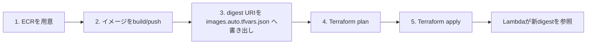
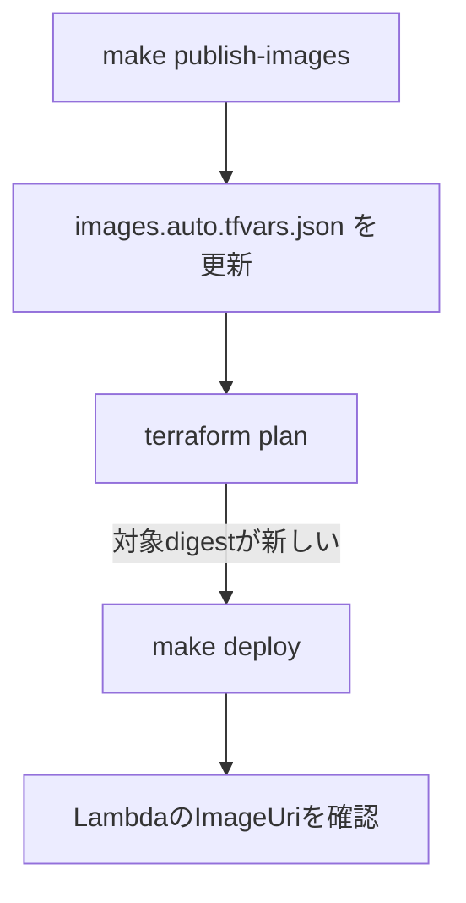

# AWS デプロイ手順（運用ランブック）

対象: このリポジトリを初回デプロイ・更新・確認・削除する担当者。正本は `Makefile`、`scripts/`、`infrastructure/terraform/` です。

## まず覚えること



`make publish-images` は **ECRへpushするだけ** です。Lambdaを新イメージへ切り替えるのは、必ず後続の `make deploy` です。

比較対象の言語は `spec/implementations.yaml` が正本です。ビルド・push・Terraform・計測はすべてこの一覧から対象を決めるため、言語ごとのURIや変数を手で渡す必要はありません。

| 操作 | 変わるもの | AWS書き込み |
| --- | --- | --- |
| `make bootstrap-ecr` | ECRリポジトリと取得ポリシー | あり |
| `make publish-images` | ECRイメージ | あり |
| `make deploy` | Lambdaを指定digestへ更新、必要なら周辺リソースも更新 | あり |
| `terraform plan` | なし。変更予定を表示 | なし |
| `make destroy` | Terraform管理リソースとECRイメージ | あり・削除 |

## 共通の準備

計測・seed で使う API URL とテーブル名は、毎回コマンドへ付ける代わりに `.env` へ置き、シェルへ一括読み込みします。

```bash
# 初回だけ: テンプレートから作成し、terraform output の値と AWS_PROFILE を書く
cp .env.example .env

# 以降のシェルでは、作業開始時に一度だけ読み込む（実行ではなく source）
source ./.env.export.sh
aws sts get-caller-identity
```

| 確認項目 | 期待値 |
| --- | --- |
| アカウント | 対象のAWSアカウント |
| リージョン | `ap-northeast-1`（`.env` の `AWS_REGION`） |
| 環境名 | `benchmark`（`.env` の `ENVIRONMENT`） |
| テーブル | `.env` の `DYNAMODB_TABLE_NAME`（APIの接続先はTerraformの出力から自動で読む） |
| 計測条件 | 全言語のLambdaの実設定と `.env` の `ARCHITECTURE` / `LAMBDA_MEMORY_MB` が一致 |

| ファイル | 用途 |
| --- | --- |
| `.env.example` | AWS向けテンプレート（Git管理） |
| `.env` | 実値（Git管理しない）。`source ./.env.export.sh` で読み込む |
| `.env.export.sh` | `KEY=VALUE` を現在のシェルへ export する。必ず `source` する |

`AWS_PROFILE` は `.env` に書いておくか、必要ならシェルで `export AWS_PROFILE=...` します。認証情報やアクセスキーは `.env` を含め表示・保存・Git管理しません。

ローカル起動（DynamoDB Local / uvicorn / RIE）向けは `.env.local` を使い、`source ./.env.export.sh --local` です。手順は README のローカル実行を参照してください。

## 初回デプロイ


| 手順 | コマンド | 目的・確認点 |
| ---: | --- | --- |
| 1 | `make bootstrap-ecr` | ECRだけを作成する。Lambdaはまだ作られない。 |
| 2 | `make publish-images` | 全言語のarm64イメージをbuildしてECRへpushし、digest固定URIを `infrastructure/terraform/images.auto.tfvars.json` へ書き出す。 |
| 3 | 下記の`terraform plan` | 作成・更新予定と対象digestを確認する。 |
| 4 | `make deploy` | Terraform apply。Lambda、API Gateway、DynamoDB、IAM、CloudWatchを作成する。 |

```bash
terraform -chdir=infrastructure/terraform plan \
  -var="aws_region=$AWS_REGION" \
  -var="environment=$ENVIRONMENT"

make deploy
```

`images.auto.tfvars.json` はTerraformが自動で読み込むため、`-var` でイメージURIを渡す必要はありません（環境ごとに異なるためGit管理しません）。`plan` を確認してから `make deploy` を実行します。`TF_AUTO_APPROVE` は通常設定しません。

## コード更新をLambdaへ反映



```bash
make publish-images
terraform -chdir=infrastructure/terraform plan \
  -var="aws_region=$AWS_REGION" \
  -var="environment=$ENVIRONMENT"
make deploy
```

イメージのタグには公開時のGitコミット（`-g<コミット>`）が入り、イメージの元になるファイルに未コミットの変更があれば `-dirty` が付きます。画面から計測を始めるときは、このタグからデプロイ済みの版を読み取り、デプロイ後にアプリのコード・依存定義・`Dockerfile` が変更されていれば計測を止めて再デプロイを促します。イメージに入らないテスト（`spec/implementations.yaml` の `test_paths`）だけの変更では止めません。計測前に変更をコミットし、`make publish-images` と `make deploy` を実行してください。

| 成功条件 | 確認コマンド |
| --- | --- |
| Lambdaが新digestを参照 | `aws lambda get-function --function-name lambda-runtime-lab-benchmark-<実装キー> --query 'Code.ImageUri' --output text` |
| 構成差分なし | `terraform plan` が `No changes` |

ECRの「最新タグ」とLambdaの参照digestは別物です。pushだけではLambdaは更新されません。

## 言語を追加する

1. `apps/<実装キー>` にアプリと `Dockerfile` を用意する（共通の `FINAL_BASE` を使う）。
2. `spec/implementations.yaml` に実装キー・表示名・`app_dir` を追加する。
3. `make contract-test` で全言語の応答が正本と一致することを確認する。
4. `make bootstrap-ecr` → `make publish-images` → `make deploy` の順に実行する。

`make bootstrap-ecr` で新しい言語のECRリポジトリができるまでは、`make publish-images` は登録先がないため停止します。実装で守ることは [ワークロードと言語の追加手順](08_ワークロードと言語の追加手順.md) を参照してください。

## デプロイ済み構成の確認

```bash
terraform -chdir=infrastructure/terraform plan \
  -var="aws_region=$AWS_REGION" \
  -var="environment=$ENVIRONMENT"
```

`images.auto.tfvars.json` が最後に公開したイメージを指している場合、`No changes` は、AWS実リソースとTerraform定義が一致していることを示します。この確認だけではリソースは変更されません。

## データ投入と計測

先に `source ./.env.export.sh` 済みなら、テーブル名を毎回付けなくて構いません。画面から計測する場合は `make ui` を使います（接続先と条件は自動で読み取ります）。

| 操作 | コマンド | 結果 |
| --- | --- | --- |
| seed | `make seed` | 決定的なテストデータを投入（`DYNAMODB_TABLE_NAME` は `.env`） |
| 小規模計測 | `WORKLOAD=health make benchmark` | 全言語へ同じ要求を送り、生データを保存（接続先はTerraformの出力） |
| 言語を絞る | `WORKLOAD=health TARGET=python,rust make benchmark` | 指定した言語だけを計測 |
| 収集 | `RUN_ID=<run-id> make collect` | CloudWatch値を収集 |
| レポート | `RUN_ID=<run-id> make report` | Markdown/CSVレポートを生成 |

生成後は [ベンチマークレポート利用ガイド](07_BENCHMARK_REPORT_GUIDE.md) に従い、
`Unclassified=0`、条件、欠損の有無を確認してから比較結果を使用します。

APIは `AWS_IAM` 認可のため、署名付き呼び出し権限が必要です。別の接続先を計測する場合は、環境変数 `<実装キー大文字>_API_URL`（例: `PYTHON_API_URL`）で上書きできます。

`ARCHITECTURE` と `LAMBDA_MEMORY_MB` は、全言語のLambdaに対する
`aws lambda get-function-configuration` の `Architectures[0]` と `MemorySize` が一致することを
確認して `.env` へ設定します。未指定の場合は条件不明のレポートを防ぐため、`make benchmark` が
計測前に停止します。

## 切戻しと削除

| 状況 | 操作 |
| --- | --- |
| 新イメージを戻す | 直前の `images.auto.tfvars.json`（または各Lambdaの `Code.ImageUri`）に戻し、`plan` を確認後に `make deploy` |
| 全削除 | `make destroy`。ECRは `force_delete` のため保存済みイメージも削除される。 |

削除前に、必要なベンチマーク結果と使用中のdigest URIを保存してください。

## コマンドと引数の一覧

| コマンド | コマンドの処理内容 | 引数 | 引数の意味 | 引数の導出元 |
| --- | --- | --- | --- | --- |
| `cp .env.example .env` | AWS向け環境変数ファイルを作成する | なし | 実値は利用者が記入 | `.env.example`。記入後の `.env` は Git 管理しない。 |
| `source ./.env.export.sh` | `.env` の `KEY=VALUE` を現在のシェルへ一括 export する | なし（既定） | AWS向け `.env` を読む | リポジトリ直下の `.env.export.sh`。`./` 実行では呼び出し元に残らない。 |
| 同上 | 同上 | `--local` | ローカル向け `.env.local` を読む | `.env.local.example` から作成。README のローカル実行向け。 |
| `export AWS_PROFILE=...` | 後続のAWS CLI・Terraformが使う認証プロファイルを選ぶ | `AWS_PROFILE` | AWS CLIのプロファイル名 | `~/.aws/config` 等。`.env` に書いてもよい。 |
| `AWS_REGION` / `ENVIRONMENT` | 対象リージョンと環境名 | 値は `.env` またはシェル | Terraform変数とリソース命名に使う | `.env` の既定は `ap-northeast-1` / `benchmark`。 |
| `aws sts get-caller-identity` | 現在の認証先アカウント・IAM主体を表示する | なし | プロファイルとリージョンは上記の環境変数を利用 | `AWS_PROFILE` と `AWS_REGION`。書き込みはしない。 |
| `make bootstrap-ecr` | 全言語のECRリポジトリとLambdaのイメージ取得ポリシーだけを作成する | `AWS_REGION`、`ENVIRONMENT` | 対象リージョンと命名環境 | 上記の環境変数。初回と言語追加時に必要。 |
| `make publish-images` | 全言語のarm64イメージをbuildしてECRへpushし、digest固定URIを `images.auto.tfvars.json` へ書き出す | `AWS_REGION`、任意の`PUBLISH_TAG` | 対象リージョン、ECRタグ | `PUBLISH_TAG` を省略するとUTC時刻とGitコミットを含む一意タグをスクリプトが生成する。 |
| `terraform -chdir=infrastructure/terraform plan ...` | 実リソースとの差分とLambda更新対象digestを表示する | `-chdir` | Terraform設定の場所 | リポジトリ内の `infrastructure/terraform`。 |
| 同上 | 同上 | `-var=aws_region=$AWS_REGION` | Terraformの `aws_region` 変数 | `AWS_REGION`。既定値は `ap-northeast-1`。 |
| 同上 | 同上 | `-var=environment=$ENVIRONMENT` | Terraformの `environment` 変数 | `ENVIRONMENT`。既定値は `dev` のため、必ず `benchmark` を渡す。 |
| `make deploy` | Terraform applyで、`images.auto.tfvars.json` のdigestを全言語のLambdaへ反映する | `AWS_REGION`、`ENVIRONMENT` | Terraformへ渡す値 | 上記の環境変数。通常は `TF_AUTO_APPROVE` を設定せず、apply確認を行う。 |
| `aws lambda get-function --function-name ... --query 'Code.ImageUri' --output text` | Lambdaが実際に参照しているdigestを取得する | `--function-name` | 確認するLambda名 | Terraform出力 `lambda_names`。現在は `lambda-runtime-lab-benchmark-<実装キー>`。 |
| `make seed` | ベンチマーク用の決定的データをDynamoDBへ投入する | `DYNAMODB_TABLE_NAME` | seed先のDynamoDBテーブル名 | `.env`（`source ./.env.export.sh` 済み）またはコマンド引数。値の正本は `terraform output -raw dynamodb_table_name`。 |
| `WORKLOAD=health make benchmark` | 全言語のIAM認可APIへ同じワークロードを実行し、生データを保存する | `WORKLOAD`、任意の`TARGET` | 実行する比較ワークロード、計測する言語（`all` か実装キーのカンマ区切り） | `spec/workloads.yaml`、`spec/implementations.yaml`。接続先はTerraform出力 `api_endpoints`。 |
| `RUN_ID=... make collect` | CloudWatchログから指定実行の計測値を収集する | `RUN_ID` | 収集対象のベンチマーク実行ID | `make benchmark` の実行結果に記録されたID。`auto` は指定不可。 |
| `RUN_ID=... make report` | 収集済みデータからMarkdown/CSVレポートを生成する | `RUN_ID` | レポート対象のベンチマーク実行ID | `make collect` に使ったIDと同じ値。 |
| `terraform -chdir=infrastructure/terraform output` | デプロイ済みAPI、Lambda、DynamoDB、ECRの値を表示する | `-chdir` | Terraform設定とstateの場所 | リポジトリ内の `infrastructure/terraform`。言語ごとの値は `api_endpoints`・`lambda_names`・`ecr_repository_urls` の対応表。 |
| `make destroy` | Terraform管理リソースを削除する | `AWS_REGION`、`ENVIRONMENT` | 作成時と同じTerraform入力。ECR削除時にはイメージも対象 | 上記の環境変数。`TF_AUTO_APPROVE` は通常設定しない。 |
