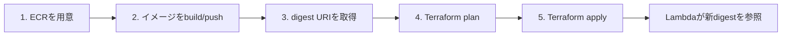
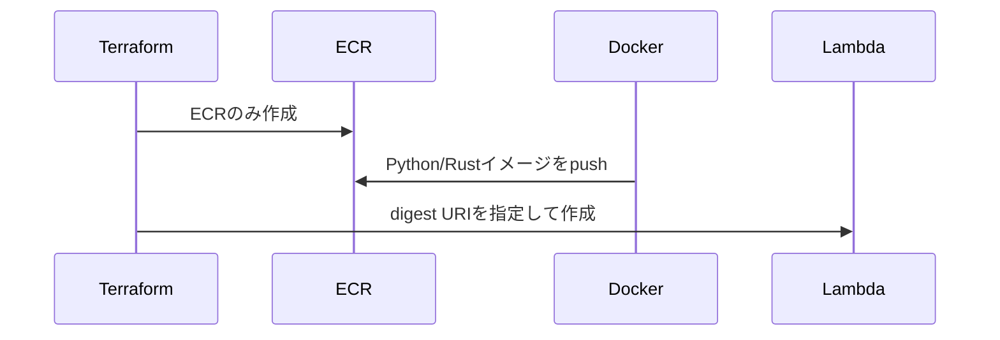
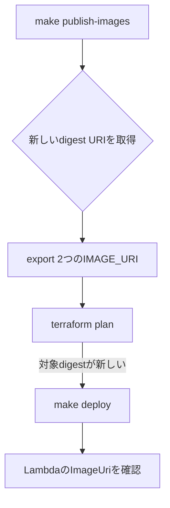

# AWS デプロイ手順（運用ランブック）

対象: このリポジトリを初回デプロイ・更新・確認・削除する担当者。正本は `Makefile`、`scripts/`、`infrastructure/terraform/` です。

## まず覚えること



`make publish-images` は **ECRへpushするだけ** です。Lambdaを新イメージへ切り替えるのは、必ず後続の `make deploy` です。

| 操作 | 変わるもの | AWS書き込み |
| --- | --- | --- |
| `make bootstrap-ecr` | ECRリポジトリと取得ポリシー | あり |
| `make publish-images` | ECRイメージ | あり |
| `make deploy` | Lambdaを指定digestへ更新、必要なら周辺リソースも更新 | あり |
| `terraform plan` | なし。変更予定を表示 | なし |
| `make destroy` | Terraform管理リソースとECRイメージ | あり・削除 |

## 共通の準備

計測・seed で使う API URL とテーブル名は、毎回コマンドへ付ける代わりに `.env` へ置き、シェルへ一括読み込みします。

```bash
# 初回だけ: テンプレートから作成し、terraform output の値と AWS_PROFILE を書く
cp .env.example .env

# 以降のシェルでは、作業開始時に一度だけ読み込む（実行ではなく source）
source ./.env.export.sh
aws sts get-caller-identity
```

| 確認項目 | 期待値 |
| --- | --- |
| アカウント | 対象のAWSアカウント |
| リージョン | `ap-northeast-1`（`.env` の `AWS_REGION`） |
| 環境名 | `benchmark`（`.env` の `ENVIRONMENT`） |
| API / テーブル | `.env` の `PYTHON_API_URL` / `RUST_API_URL` / `DYNAMODB_TABLE_NAME` |
| 計測条件 | 両Lambdaの実設定と `.env` の `ARCHITECTURE` / `LAMBDA_MEMORY_MB` が一致 |

| ファイル | 用途 |
| --- | --- |
| `.env.example` | AWS向けテンプレート（Git管理） |
| `.env` | 実値（Git管理しない）。`source ./.env.export.sh` で読み込む |
| `.env.export.sh` | `KEY=VALUE` を現在のシェルへ export する。必ず `source` する |

`AWS_PROFILE` は `.env` に書いておくか、必要ならシェルで `export AWS_PROFILE=...` します。認証情報やアクセスキーは `.env` を含め表示・保存・Git管理しません。

ローカル起動（DynamoDB Local / uvicorn / RIE）向けは `.env.local` を使い、`source ./.env.export.sh --local` です。手順は README のローカル実行を参照してください。

## 初回デプロイ



| 手順 | コマンド | 目的・確認点 |
| ---: | --- | --- |
| 1 | `make bootstrap-ecr` | ECRだけを作成する。Lambdaはまだ作られない。 |
| 2 | `make publish-images` | arm64イメージをbuildしてECRへpushする。出力の2つの`export`行を控える。 |
| 3 | 出力された `export PYTHON_IMAGE_URI=...` と `export RUST_IMAGE_URI=...` を実行 | Lambdaに固定するdigestを指定する。 |
| 4 | 下記の`terraform plan` | 作成・更新予定と対象digestを確認する。 |
| 5 | `make deploy` | Terraform apply。Lambda、API Gateway、DynamoDB、IAM、CloudWatchを作成する。 |

```bash
terraform -chdir=infrastructure/terraform plan \
  -var="aws_region=$AWS_REGION" \
  -var="environment=$ENVIRONMENT" \
  -var="python_image_uri=$PYTHON_IMAGE_URI" \
  -var="rust_image_uri=$RUST_IMAGE_URI"

make deploy
```

`plan` を確認してから `make deploy` を実行します。`TF_AUTO_APPROVE` は通常設定しません。

## コード更新をLambdaへ反映



```bash
make publish-images
# 表示された2つの export ..._IMAGE_URI=... をこのシェルで実行する

terraform -chdir=infrastructure/terraform plan \
  -var="aws_region=$AWS_REGION" \
  -var="environment=$ENVIRONMENT" \
  -var="python_image_uri=$PYTHON_IMAGE_URI" \
  -var="rust_image_uri=$RUST_IMAGE_URI"

make deploy
```

| 成功条件 | 確認コマンド |
| --- | --- |
| Lambdaが新digestを参照 | `aws lambda get-function --function-name lambda-runtime-lab-benchmark-python --query 'Code.ImageUri' --output text` |
| Rustも同様 | 上記の関数名を `lambda-runtime-lab-benchmark-rust` に変更 |
| 構成差分なし | 現在の2つのImageUriを環境変数に設定して `terraform plan` が `No changes` |

ECRの「最新タグ」とLambdaの参照digestは別物です。pushだけではLambdaは更新されません。

## デプロイ済み構成の確認

```bash
export PYTHON_IMAGE_URI="$(aws lambda get-function \
  --function-name lambda-runtime-lab-benchmark-python \
  --query 'Code.ImageUri' --output text)"
export RUST_IMAGE_URI="$(aws lambda get-function \
  --function-name lambda-runtime-lab-benchmark-rust \
  --query 'Code.ImageUri' --output text)"

terraform -chdir=infrastructure/terraform plan \
  -var="aws_region=$AWS_REGION" \
  -var="environment=$ENVIRONMENT" \
  -var="python_image_uri=$PYTHON_IMAGE_URI" \
  -var="rust_image_uri=$RUST_IMAGE_URI"
```

`No changes` は、AWS実リソースとTerraform定義が一致していることを示します。この確認だけではリソースは変更されません。

## データ投入と計測

先に `source ./.env.export.sh` 済みなら、URL やテーブル名を毎回付けなくて構いません。

| 操作 | コマンド | 結果 |
| --- | --- | --- |
| seed | `make seed` | 決定的なテストデータを投入（`DYNAMODB_TABLE_NAME` は `.env`） |
| 小規模計測 | `WORKLOAD=health make benchmark` | 生データを保存（API URL は `.env`） |
| 収集 | `RUN_ID=<run-id> make collect` | CloudWatch値を収集 |
| レポート | `RUN_ID=<run-id> make report` | Markdown/CSVレポートを生成 |

生成後は [ベンチマークレポート利用ガイド](07_BENCHMARK_REPORT_GUIDE.md) に従い、
`Unclassified=0`、条件、欠損の有無を確認してから比較結果を使用します。

API URLとテーブル名は `terraform -chdir=infrastructure/terraform output` で確認し、`.env` へ反映します。APIは `AWS_IAM` 認可のため、署名付き呼び出し権限が必要です。

`ARCHITECTURE` と `LAMBDA_MEMORY_MB` は、両Lambdaに対する
`aws lambda get-function-configuration` の `Architectures[0]` と `MemorySize` が一致することを
確認して `.env` へ設定します。未指定の場合は条件不明のレポートを防ぐため、`make benchmark` が
計測前に停止します。

## 切戻しと削除

| 状況 | 操作 |
| --- | --- |
| 新イメージを戻す | 直前に記録した2つのdigest URIを `PYTHON_IMAGE_URI` / `RUST_IMAGE_URI` に設定し、`plan` を確認後に `make deploy` |
| 全削除 | 現在の2つのImageUriを設定して `make destroy`。ECRは `force_delete` のため保存済みイメージも削除される。 |

削除前に、必要なベンチマーク結果と使用中のdigest URIを保存してください。

## コマンドと引数の一覧

| コマンド | コマンドの処理内容 | 引数 | 引数の意味 | 引数の導出元 |
| --- | --- | --- | --- | --- |
| `cp .env.example .env` | AWS向け環境変数ファイルを作成する | なし | 実値は利用者が記入 | `.env.example`。記入後の `.env` は Git 管理しない。 |
| `source ./.env.export.sh` | `.env` の `KEY=VALUE` を現在のシェルへ一括 export する | なし（既定） | AWS向け `.env` を読む | リポジトリ直下の `.env.export.sh`。`./` 実行では呼び出し元に残らない。 |
| 同上 | 同上 | `--local` | ローカル向け `.env.local` を読む | `.env.local.example` から作成。README のローカル実行向け。 |
| `export AWS_PROFILE=...` | 後続のAWS CLI・Terraformが使う認証プロファイルを選ぶ | `AWS_PROFILE` | AWS CLIのプロファイル名 | `~/.aws/config` 等。`.env` に書いてもよい。 |
| `AWS_REGION` / `ENVIRONMENT` | 対象リージョンと環境名 | 値は `.env` またはシェル | Terraform変数とリソース命名に使う | `.env` の既定は `ap-northeast-1` / `benchmark`。 |
| `aws sts get-caller-identity` | 現在の認証先アカウント・IAM主体を表示する | なし | プロファイルとリージョンは上記の環境変数を利用 | `AWS_PROFILE` と `AWS_REGION`。書き込みはしない。 |
| `make bootstrap-ecr` | ECRリポジトリとLambdaのイメージ取得ポリシーだけを作成する | `AWS_REGION`、`ENVIRONMENT` | 対象リージョンと命名環境 | 上記の環境変数。初回だけ必要。 |
| `make publish-images` | Python/Rustのarm64イメージをbuildしてECRへpushし、digest URIを表示する | `AWS_REGION`、任意の`PUBLISH_TAG` | 対象リージョン、ECRタグ | `AWS_REGION` は上記。`PUBLISH_TAG` を省略するとUTC時刻ベースの一意タグをスクリプトが生成する。 |
| `export PYTHON_IMAGE_URI=...` | Python Lambdaが参照するコンテナdigestを指定する | `PYTHON_IMAGE_URI` | Python ECRの `repository@sha256:...` | 新規更新時は `make publish-images` の出力。現状確認時は `aws lambda get-function` の `Code.ImageUri`。 |
| `export RUST_IMAGE_URI=...` | Rust Lambdaが参照するコンテナdigestを指定する | `RUST_IMAGE_URI` | Rust ECRの `repository@sha256:...` | 新規更新時は `make publish-images` の出力。現状確認時は `aws lambda get-function` の `Code.ImageUri`。 |
| `terraform -chdir=infrastructure/terraform plan ...` | 実リソースとの差分とLambda更新対象digestを表示する | `-chdir` | Terraform設定の場所 | リポジトリ内の `infrastructure/terraform`。 |
| 同上 | 同上 | `-var=aws_region=$AWS_REGION` | Terraformの `aws_region` 変数 | `AWS_REGION`。既定値は `ap-northeast-1`。 |
| 同上 | 同上 | `-var=environment=$ENVIRONMENT` | Terraformの `environment` 変数 | `ENVIRONMENT`。既定値は `dev` のため、必ず `benchmark` を渡す。 |
| 同上 | 同上 | `-var=python_image_uri=$PYTHON_IMAGE_URI` | Python Lambdaへ設定する不変digest URI | `make publish-images` 出力、または現在のPython Lambda設定。 |
| 同上 | 同上 | `-var=rust_image_uri=$RUST_IMAGE_URI` | Rust Lambdaへ設定する不変digest URI | `make publish-images` 出力、または現在のRust Lambda設定。 |
| `make deploy` | Terraform applyで、指定digestをLambdaへ反映する | `AWS_REGION`、`ENVIRONMENT`、`PYTHON_IMAGE_URI`、`RUST_IMAGE_URI` | 上記4値をTerraformへ渡す | 上記の環境変数。通常は `TF_AUTO_APPROVE` を設定せず、apply確認を行う。 |
| `aws lambda get-function --function-name ... --query 'Code.ImageUri' --output text` | Lambdaが実際に参照しているdigestを取得する | `--function-name` | 確認するLambda名 | Terraform出力 `python_lambda_name` / `rust_lambda_name`。現在は `lambda-runtime-lab-benchmark-python` / `-rust`。 |
| 同上 | 同上 | `--query 'Code.ImageUri'` | AWS応答からイメージURIだけを抽出するJMESPath式 | AWS CLIの出力形式。URIを `*_IMAGE_URI` へ再利用する。 |
| 同上 | 同上 | `--output text` | 抽出値をシェル代入しやすいテキスト形式にする | AWS CLIの出力形式。 |
| `make seed` | ベンチマーク用の決定的データをDynamoDBへ投入する | `DYNAMODB_TABLE_NAME` | seed先のDynamoDBテーブル名 | `.env`（`source ./.env.export.sh` 済み）またはコマンド引数。値の正本は `terraform output -raw dynamodb_table_name`。 |
| `WORKLOAD=health make benchmark` | 2つのIAM認可APIへ同じワークロードを実行し、生データを保存する | `PYTHON_API_URL`、`RUST_API_URL` | Python/Rust APIのエンドポイント | `.env`（`source ./.env.export.sh` 済み）またはコマンド引数。値の正本は Terraform出力 `python_api_endpoint` / `rust_api_endpoint`。 |
| 同上 | 同上 | `WORKLOAD=health` | 実行する比較ワークロード | `spec/workloads.yaml`。最小確認では `health`、全候補は同ファイルに定義。 |
| `RUN_ID=... make collect` | CloudWatchログから指定実行の計測値を収集する | `RUN_ID` | 収集対象のベンチマーク実行ID | `make benchmark` の実行結果に記録されたID。`auto` は指定不可。 |
| `RUN_ID=... make report` | 収集済みデータからMarkdown/CSVレポートを生成する | `RUN_ID` | レポート対象のベンチマーク実行ID | `make collect` に使ったIDと同じ値。 |
| `terraform -chdir=infrastructure/terraform output` | デプロイ済みAPI、Lambda、DynamoDB、ECRの値を表示する | `-chdir` | Terraform設定とstateの場所 | リポジトリ内の `infrastructure/terraform`。個別値には `-raw <output名>` を追加する。 |
| `make destroy` | Terraform管理リソースを削除する | `AWS_REGION`、`ENVIRONMENT`、`PYTHON_IMAGE_URI`、`RUST_IMAGE_URI` | 作成時と同じTerraform入力。ECR削除時にはイメージも対象 | デプロイ済みLambdaの `Code.ImageUri` と上記の環境変数。`TF_AUTO_APPROVE` は通常設定しない。 |
