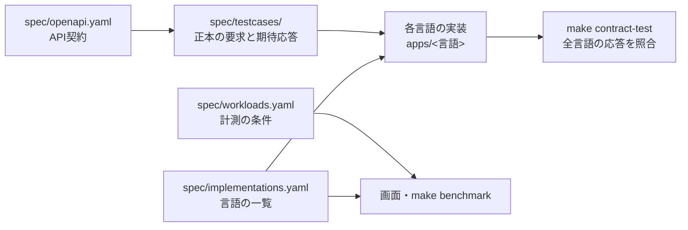

# ワークロードと言語の追加手順

対象: 計測する処理（ワークロード）や比較する言語を増やす担当者。
正本は `spec/implementations.yaml`（言語の一覧）、`spec/workloads.yaml`（ワークロードの一覧）、`spec/openapi.yaml`（API契約）、`spec/testcases/`（正本の要求と期待応答）です。

## 全体像



- 言語は `spec/implementations.yaml` に一行足すと、ビルド・ECR・Lambda・API・計測・画面・Contract Test・CIの対象になります。
- ワークロードは `spec/workloads.yaml` に足すと、画面の選択肢と `make benchmark` の対象になります。
- 新しいワークロードを一部の言語だけで先に計測したい場合は、そのワークロードとテストケースに `implementations`（対応する言語の一覧）を書きます。対応していない言語は計測せず、画面で「未対応」と表示します（欠損とは区別します）。

## 新しいワークロードを追加する

既存のエンドポイントの条件違い（件数や並行数を変えるなど）なら、手順1だけで足ります。新しい処理（エンドポイント）が必要なら、手順2〜5も行います。

| 手順 | 作業 | 確認 |
| ---: | --- | --- |
| 1 | `spec/workloads.yaml` に定義を足す（`description`・`method`・`path`・回数・本文） | 画面の選択肢に出る |
| 2 | `spec/openapi.yaml` に新しいエンドポイントの契約を足す | 入力の検証規則とエラーを決めておく |
| 3 | `spec/testcases/<名前>.json` に正本の要求と期待応答を足す | 正常系と主要な異常系 |
| 4 | 実装した言語で単体テスト（正本ケースの読込を含む）を通す | 各言語の `make test-<言語>` |
| 5 | `make contract-test` | 対応する全言語の応答が正本と一致する |

一部の言語だけで先に実装する場合は、手順1の定義と手順3のテストケースファイルの両方に、同じ対応言語を書きます。

```yaml
# spec/workloads.yaml
  report-export:
    description: DynamoDBから100件を読み、CSVに整形して返す処理です。
    method: POST
    path: /reports
    iterations: 100
    implementations: [python, rust]   # 省略すると全言語
```

```json
{
  "contract_version": "1.0.0",
  "endpoint": "POST /reports",
  "implementations": ["python", "rust"],
  "cases": []
}
```

残りの言語を実装したら、両方の `implementations` に言語を足します（全言語がそろったら項目ごと消してかまいません）。

## 新しい言語を追加する

| 手順 | 作業 | 確認 |
| ---: | --- | --- |
| 1 | `apps/<実装キー>` に、共通契約の全エンドポイントと単体テストを実装する | 正本ケース（`spec/testcases/`）を読むテストが通る |
| 2 | `Dockerfile` を用意する。最終ステージは共通の `FINAL_BASE`（AL2023 OS-only）にする | `make build IMPLEMENTATIONS=<実装キー>` |
| 3 | `spec/implementations.yaml` に実装キー・表示名・`app_dir`・`test_paths`（イメージに入らないテストのパス）・`artifact_paths` を足す | 表示順の先頭が差分の基準になる |
| 4 | `make contract-test` | 全言語の応答が正本と一致する |
| 5 | `Makefile` と `.github/workflows/ci.yml` に、その言語のlint・テストを足す | `make lint`、`make test` |
| 6 | `make bootstrap-ecr` → `make publish-images` → `make deploy` | 画面の計測開始で言語が選べる |

### 実装で守ること

ほかの言語の実装（`apps/rust` が手で検証する方式で読みやすい）と同じ振る舞いにします。

- **JSONを厳密に解析する。** 重複キーは `invalid_json`、`1.0` や `"1"` は整数として受け付けず `type:integer`、範囲外の巨大な整数は `minimum`／`maximum`。標準の解析器がこれらを区別できない言語（TypeScriptなど）は、自前の解析器を使います。
- **検証の順序とエラーの並び順を合わせる。** 計測相関ヘッダー → JSON解析 → 構造の検証 → 重複・作業量・プロファイル。エラーの詳細はフィールド名、理由の順に並べます。
- **計測相関ログを一リクエスト一行のJSONで標準出力へ書く。** トップレベルに `implementation`・`lambda_request_id`・`benchmark_run_id`・`benchmark_request_index`・`route`・`profile`・`status_code` を置きます。ランタイムのロガーは本文を `message` に包むことがあるため、標準出力へ直接書きます。これがないと、計測とLambdaの実行時間・メモリ・料金を結び付けられません。
- **ベースイメージを全言語で同じにする。** 言語のランタイムは、AWS公式イメージの `/var/lang`（言語本体）と `/var/runtime`（Lambdaのランタイムインターフェース）を共通ベースの上へコピーして再現します（Python・TypeScript・Javaの `Dockerfile` を参照）。

### よくある失敗

| 症状 | 原因 | 対処 |
| --- | --- | --- |
| 画面で「デプロイされていません」 | 一覧に足したがLambdaを作っていない | `make bootstrap-ecr`、`make publish-images`、`make deploy` |
| `make publish-images` が「ECRリポジトリがありません」で止まる | `make bootstrap-ecr` を実行していない | 先に `make bootstrap-ecr` |
| 画面で「デプロイ後に変更されています」 | アプリのコード・依存定義・`Dockerfile` を変更した後に公開していない（テストだけの変更では出ない） | 変更をコミットし、`make publish-images` と `make deploy` |
| 計測後に「Lambda側の記録が得られていません」 | 相関ログの形式が違う | 上記の「計測相関ログ」の項目と出力先を確認する |
