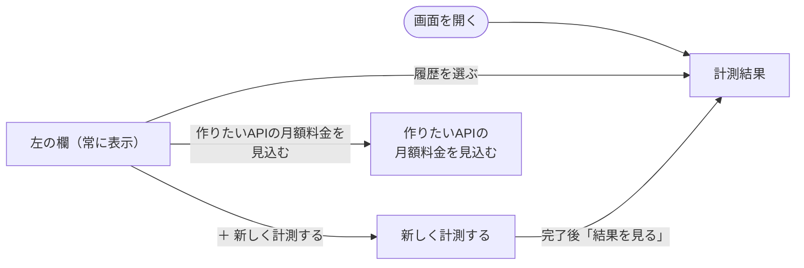
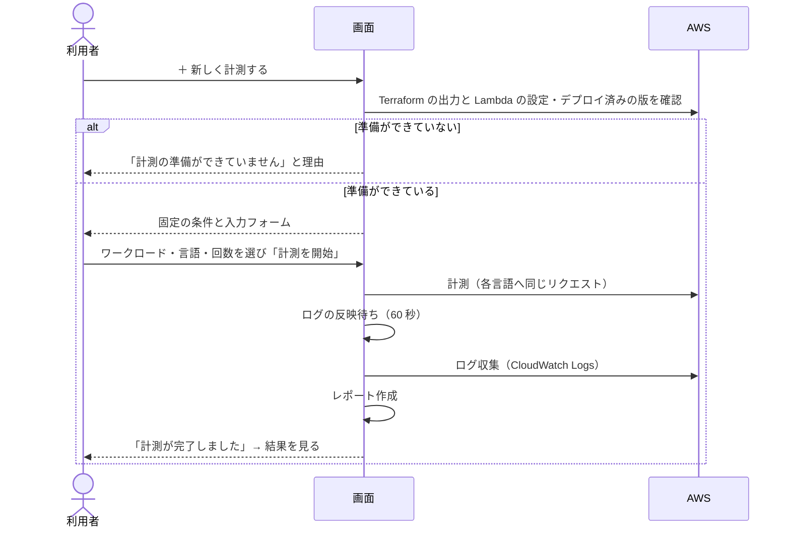

# 画面の操作ガイド

対象: ブラウザの画面（`make ui`）で計測・比較・見積もりをする人。
画面の裏で動く仕組みやコマンドの全体像は [全体構成と操作の地図](10_全体構成と操作の地図.md) を参照してください。

## 1. この画面でできること

| やりたいこと | 使う画面 | 結果 |
| --- | --- | --- |
| 過去の計測結果を見て、言語を比べる | 計測結果（初期表示） | どの言語が安い・速いか、その根拠の数値 |
| 新しく計測する | 新しく計測する | AWS 上の各言語の Lambda に同じリクエストを送り、結果を保存する |
| これから作る API の月額料金を言語ごとに見積もる | 作りたいAPIの月額料金を見込む | 言語ごとの月額料金（見込み）と処理時間 |

画面からはデプロイ・データ投入・削除はできません（ターミナルで行います）。

## 2. 起動と終了

```bash
make ui                  # http://127.0.0.1:8765/ を開く。Ctrl+C で終了
UI_PORT=9000 make ui     # ポートを変える場合
```

| 前提 | 理由 |
| --- | --- |
| AWS にログイン済み（`aws sts get-caller-identity` が成功する） | Lambda の設定を読み、計測リクエストに署名するため |
| `make deploy` 済み（Terraform の出力がある） | 接続先 URL とロググループを Terraform の出力から読むため |
| 計測結果を見るだけなら AWS は不要 | 結果は手元の `results/raw/` から読む |

`.env` の読み込みは不要です。接続先と条件は計測のたびに自動で読み直します。
画面は自分のマシン（`127.0.0.1`）からだけ開けます。

## 3. 画面の構成

```text
┌──────────────────────────────────────────────────────────────────────┐
│ Lambda 言語比較                                                       │
├──────────────────────┬───────────────────────────────────────────────┤
│ 計測履歴  [再読み込み] │                                               │
│ [＋ 新しく計測する]   │   右側: 選んだ画面の内容                        │
│ [作りたいAPIの月額     │   ・計測結果（履歴を選んだとき）                 │
│   料金を見込む]       │   ・新しく計測する                               │
│                      │   ・作りたいAPIの月額料金を見込む                 │
│ health        要確認 │                                               │
│ 2026/10/20 01:48     │                                               │
│ Python · Rust · …    │                                               │
│ arm64 · 512 MB · 各30回│                                              │
│ …                    │                                               │
└──────────────────────┴───────────────────────────────────────────────┘
```

- 左の **計測履歴** は新しい順です。1件ごとに、ワークロード名、開始日時、計測した言語、条件（アーキテクチャ・メモリ・回数）を示します。
- **要確認** が付いた計測は、そのまま比較に使えない理由があります（理由は結果画面の先頭に出ます）。
- 計測の実行中に別の画面を見ていると、画面上部に「計測を実行中」の帯が出ます。「進み具合を見る」で計測画面へ戻れます。



画面を開くと、最新の計測結果を表示します。左の欄はどの画面でも表示され、そこから3つの画面を行き来します。

## 4. 計測結果を読む

履歴を選ぶと、右側に上から次の順で出ます。結論が先、根拠は後ろです。

| 順 | 区画 | 見るところ | 分かること |
| ---: | --- | --- | --- |
| 1 | 確認が必要な点（あるときだけ） | 理由の一覧 | その計測を比較に使ってよいか |
| 2 | 結論 | 「最も安い」「普段の処理が最も速い」「コールドスタートが最も短い」 | 指標ごとの一番の言語と、一番不利な言語との差（×倍率） |
| 3 | 言語ごとの比較 | ★（最も有利）と ×（最良との比） | 全言語を6つの指標で横並びに比べる |
| 4 | 指標ごとの詳しい比較 | 指標と対象を選ぶ棒グラフ（P50・P95・P99） | ばらつき・まれに遅いケース |
| 5 | すべての指標を数値表で見る（開閉式） | 数値 | グラフの元の値 |
| 6 | 計測件数 | 「ログと未結合」が 0 か | Lambda 側の指標が全件そろっているか |
| 7 | 実験条件 | 回数・同時実行数・メモリ・Git リビジョン・料金表 | 別の計測と比べてよいか |
| 8 | コンテナイメージの情報（あるときだけ） | イメージの容量など | デプロイ成果物の大きさ |

### 「要確認」の理由と対処

結果画面の先頭「この計測には確認が必要な点があります」に、次の理由が出ます。

| 理由 | 意味 | 対処 |
| --- | --- | --- |
| ドライランの結果です | 実際の API を呼んでいない | 比較に使わない |
| 計測した言語が一つだけのため、比較できません | 比べる相手がいない | 二つ以上の言語で計測し直す |
| アーキテクチャまたはメモリ設定が記録されていません | 古い形式の計測。料金を比べられない | 新しく計測し直す |
| Lambdaのログを収集していません | `make collect` をしていない。応答時間以外が出ない | `RUN_ID=<計測ID> make collect`（計測から14日以内） |
| N件中M件の計測で、Lambda側の記録が得られていません（実行レポートを読み取れませんでした） | ログの収集が不完全 | ログを再収集する |
| 同上（計測番号をログに出力していない） | 古いアプリのまま計測した | 最新のアプリをデプロイして計測し直す |
| 同上（対応するLambdaのログが見つかりませんでした） | ログの反映前に収集した、または保持期間（14日）を過ぎた | 時間をおいて再収集する。14日を過ぎたら計測し直す |

### 指標の意味

どの指標も **小さいほど有利** です。時間とメモリは中央値（P50）です。

| 指標 | 何を表すか | 判断に使う場面 |
| --- | --- | --- |
| 料金（総額） | 100万リクエストあたりの Lambda 料金。リクエスト料金 $0.20 を含む | 運用費の比較 |
| うち実行時間分 | 総額からリクエスト料金を除いた部分。言語の差はここに出る | 言語による料金差の大きさ |
| 処理時間（普段） | 起動済みの実行環境で Lambda が処理した時間。回線を含まない | 言語と実装そのものの速さ |
| コールドスタート | 新しい実行環境の起動にかかった時間 | しばらく呼ばれなかった後や急なアクセス増の最初の遅れ |
| 応答時間 | 手元から見たリクエストから応答までの時間。回線を含む | 利用者の待ち時間の目安 |
| メモリ使用量 | 1回の実行で使ったメモリの最大値 | メモリ設定をどこまで下げられるか |

### 詳しい比較の切り替え

| 操作 | 選択肢 | 使い分け |
| --- | --- | --- |
| 指標 | 応答時間 / Lambda実行時間 / 課金対象時間 / 初期化時間 / 最大メモリ使用量 | 比べたい観点を選ぶ |
| 対象の計測 | 全体 / コールドスタート / ウォームスタート | 普段の性能は **ウォームスタート**、起動の遅さは **コールドスタート** |

P50 は普段の値、P95・P99 はまれに起きる遅いケースの値です。P50 と P99 の差が小さいほど安定しています。

### 表示の読み方

| 表示 | 意味 |
| --- | --- |
| 未取得 | 値を記録できなかった（ログ未収集など）。0 ではない |
| 未計測 | その言語の値がない |
| 起動なし | その計測にコールドスタートが含まれていない。ウォームアップの結果は記録しないため、ウォームアップを1回以上にすると起動はたいていウォームアップ中に済む |
| 「このワークロードは ○○ に未対応」 | その言語はこの処理をまだ実装していない（欠損ではない） |

## 5. 新しく計測する

「＋ 新しく計測する」を押すと、AWS 上の設定を読み取ってからフォームが出ます（数秒かかります）。

### 操作の流れ



### 入力項目

| 項目 | 内容 | 既定値 | 範囲 |
| --- | --- | --- | --- |
| ワークロード | 計測する処理。選ぶと説明と回数の既定値が入る | 一覧の先頭 | — |
| 計測する言語 | 比べる言語。二つ以上を選ぶ。未対応の言語は選べず「（未対応）」と出る | 対応する全言語 | 2言語以上 |
| 反復回数（各実装） | 各言語に送る計測用のリクエスト数 | ワークロードごと | 1〜2000 |
| 同時実行数 | 同時に送るリクエスト数 | ワークロードごと | 1〜32 |
| ウォームアップ（各実装） | 計測前に送る、結果に含めないリクエスト数 | ワークロードごと | 0〜200 |

**固定の条件**（アーキテクチャ・Lambda メモリ・リージョン）は AWS 上の Lambda の実際の設定で、画面では変えられません。変えるときは Terraform で全言語をそろえて変更します。

### 開始前の確認

「計測を開始」の上に、次の2行が出ます。

| 表示 | 意味 |
| --- | --- |
| 「○○ にそれぞれ N 回（ウォームアップ M 回を含む）、合計 X リクエストを送ります。」 | 送信量 |
| 「この計測にかかる Lambda 料金: 約 $…」 | **この計測そのもの** にかかる料金の見込み。同じワークロードの過去の実測から計算する |
| 「この計測にかかる料金: ○○ はこのワークロードを計測したことがないため、見込みを出せません」 | 過去の実測がないだけ。計測は開始できる |

この料金は「作りたいAPIの月額料金」とは別物です（[7章](#7-作りたいapiの月額料金を見込む)）。

### 進み具合と終わり方

| 状態 | 表示 | できる操作 |
| --- | --- | --- |
| 実行中 | 「計測を実行中です」と4工程（計測 → ログの反映待ち → ログ収集 → レポート作成） | 中止する |
| 完了 | 「計測が完了しました」 | 結果を見る |
| 失敗 | 「計測に失敗しました」とコマンド出力の末尾 | 原因を直して計測し直す |
| 中止 | 「計測を中止しました。途中までの結果は比較に使えません。」 | 計測し直す |

計測は同時に一件だけです。実行中は新しい計測を開始できません。ブラウザを閉じても計測は続きますが、ターミナルで `make ui` を止めると計測は途中で終わり、ログ収集とレポート作成は行われません。

## 6. 「計測の準備ができていません」と出たら

理由ごとの対処です。直したら「設定を再確認」を押します（画面の起動し直しは不要）。

| 表示される理由 | 原因 | 対処 |
| --- | --- | --- |
| AWS の認証情報が見つからないか、期限が切れています | ログインしていない・期限切れ | ターミナルで AWS にログインし直す |
| terraform コマンドが見つかりません | Terraform が入っていない | Terraform をインストールする |
| Terraform の出力を読めません | デプロイしていない、または別の場所で実行している | `make deploy` 済みか確認する |
| Lambda 関数 ○○ が（リージョン）に見つかりません | 削除済み、またはリージョンが違う | `AWS_REGION` とデプロイ状況を確認する |
| 利用中の AWS 認証情報では Lambda の設定を読めません | 権限が足りない | `lambda:GetFunctionConfiguration` などの権限がある認証情報を使う |
| AWS に接続できませんでした | ネットワークの問題 | 接続を確認して「設定を再確認」 |
| ○○ の Lambda がデプロイされていません | 言語を一覧に足したが Lambda がない | `make bootstrap-ecr` → `make publish-images` → `make deploy` |
| 言語ごとの Lambda で設定が異なります | メモリなどが言語間でそろっていない | Terraform で同じ値にそろえて `make deploy` |
| 環境変数の条件（ARCHITECTURE=…）が Lambda の実設定と異なります | `.env` を読み込んだシェルで起動し、値が古い | `.env` を実設定に合わせるか、読み込まずに `make ui` |
| ○○ のデプロイ済みイメージを確認できませんでした | 版の確認に必要な権限（`lambda:GetFunction`・`ecr:DescribeImages`）がない、または関数がない | 権限のある認証情報を使うか、デプロイ状況を確認する |
| ○○ のデプロイ済みイメージがどのコミットから作られたか分かりません | タグにコミットがない古い方法で公開した | `make publish-images` → `make deploy` |
| ○○ のアプリはデプロイ後（コミット）に変更されています | アプリのコード・依存定義・Dockerfile をデプロイ後に変えた | 変更をコミットし、`make publish-images` → `make deploy` |
| デプロイ済みイメージは、未コミットの変更を含めて作られています | コミット前の状態で公開した | コミットしてから `make publish-images` → `make deploy` |
| コミット ○○ が手元の履歴にありません | 別ブランチ・別のクローンから公開した | 手元の最新から `make publish-images` → `make deploy` |

アプリのテスト（`apps/<言語>/tests` など、イメージに入らないもの）だけを直した場合は、再デプロイは不要です。

## 7. 作りたいAPIの月額料金を見込む

これから作る API が、計測済みのどの処理に近いかを割合で入れると、言語ごとの月額の Lambda 料金と処理時間を見積もります。**実績ではなく見込み** です。

### 使い方

1. 左の「作りたいAPIの月額料金を見込む」を押す。
2. 各ワークロードに、作りたい API のリクエストがどれに近いかを割合で入れる（合計 100%）。
3. 月間リクエスト数と、コールドスタートの割合を入れる。
4. 下の表に、言語ごとの見込みが安い順に出る（入力を変えるとすぐに計算し直す）。

### 入力例

「商品を1件返す API が7割、5件を集計する API が3割、月100万リクエスト、アクセスは時々」の場合:

| 入力 | 値 |
| --- | --- |
| items | 70% |
| aggregate-concurrent | 30% |
| ほかのワークロード | 0% |
| 月間リクエスト数 | 1000000 |
| コールドスタートの割合 | 1（%） |
| Lambda の条件 | 計測したメモリ設定（例: arm64 · 512 MB） |

### ワークロードの選び方

| 作りたい処理 | 近いワークロード |
| --- | --- |
| 外部を呼ばない軽い応答（死活確認など） | health |
| JSON を受けて検証・整形して返す（小さい） | transform-small |
| 同上（件数が多い・並べ替えあり） | transform-large |
| CPU を使う計算 | compute-sequential |
| DB から1件読んで返す | items |
| DB から複数件を順番に読んで集計 | aggregate-sequential |
| DB から複数件を同時に読んで集計 | aggregate-concurrent |

### コールドスタートの割合の目安

| アクセスの頻度 | 割合 |
| --- | --- |
| 常にアクセスがある | 0.1% |
| 時々 | 1〜5% |
| まれ | 10% 以上 |

### 結果の読み方

| 列 | 意味 |
| --- | --- |
| 月額料金（見込み） | リクエスト料金と実行時間分の合計。★が最も安い言語、×は最も安い言語との比 |
| うち実行時間分 | 言語による差が出る部分 |
| 処理時間（普段・平均） | ウォームスタート時の Lambda 処理時間を割合で重み付けした平均 |
| コールドスタート時の追加 | その言語の初期化時間（中央値）。実測がなければ「実測なし」 |
| 見込めません: ○○ の実測がありません | 割合を入れたワークロードを、その言語で計測していない |

表の下の注記も確認してください。

| 注記 | 意味 | 精度を上げるには |
| --- | --- | --- |
| 初期化時間の分の料金を足して近似しています | コールドスタートの実測がないワークロードを、その言語の初期化時間で近似した | そのワークロードをコールドスタートを含めて計測する |
| コールドスタート分の料金を含めていません（実際はこれより高くなります） | その言語に初期化時間の実測が一つもない | しばらく呼ばれていない状態から、ウォームアップを 0 回にして計測する |

含まない費用: API Gateway・DynamoDB・データ転送・Free Tier。料金表の日付は注記に出ます。

### 見込みが出ないとき

| 表示 | 対処 |
| --- | --- |
| 見込みに使える計測がありません | 「新しく計測する」で、近いワークロードを計測する |
| 割合の合計: N%（100% にしてください） | 合計を 100% にする（それまでは計算しない） |
| 見込めません: ○○ の実測がありません | その言語を含めて、そのワークロードを計測する |

## 8. こうしたいときは

| したいこと | 操作 |
| --- | --- |
| 一番安い言語を知りたい | 計測結果の「結論」→「最も安い」 |
| 料金差が言語によるものか知りたい | 「言語ごとの比較」の「うち実行時間分」 |
| 起動の遅さを比べたい | 「詳しい比較」で指標「初期化時間」、対象「コールドスタート」 |
| 普段の速さを回線の影響なしで比べたい | 「詳しい比較」で指標「Lambda実行時間」、対象「ウォームスタート」 |
| まれに遅いケースを比べたい | 「詳しい比較」の P95・P99 |
| メモリ設定を下げられるか知りたい | 「言語ごとの比較」の「メモリ使用量」と実験条件の「Lambda メモリ」 |
| 結果が信用できるか確かめたい | 「確認が必要な点」がない・「計測件数」の「ログと未結合」が 0・「実験条件」がそろっている |
| 2言語だけで比べたい | 計測画面の「計測する言語」で二つだけ選ぶ |
| コールドスタートも計測したい | しばらく呼ばれていない状態で、ウォームアップを 0 回にして計測する |
| まず少ない回数で試したい | 反復回数を減らす（例: 20）。開始前に送信量と料金が出る |
| 途中でやめたい | 「中止する」（途中までの結果は比較に使えない） |
| 計測の結果をファイルで見たい | `results/reports/<計測ID>.md`（人が読む）・`.csv`（表計算） |
| 作るAPIの運用費を言語ごとに見積もりたい | 「作りたいAPIの月額料金を見込む」 |
| 履歴が増えない・古い | 「再読み込み」 |
| 画面に「画面のサーバーに接続できません」と出る | ターミナルで `make ui` が動いているか確認する |

## 9. 用語

| 用語 | 意味 |
| --- | --- |
| ワークロード | 計測する処理の種類（例: health、items）。定義は `spec/workloads.yaml` |
| コールドスタート | 新しい実行環境の起動を伴う呼び出し。初期化の分だけ遅く、料金も増える |
| ウォームスタート | 起動済みの実行環境での呼び出し。普段の性能 |
| ウォームアップ | 計測前に送る、結果に含めないリクエスト。実行環境を温める |
| P50・P95・P99 | 全計測を小さい順に並べたとき、50%・95%・99% の位置の値 |
| 課金対象時間 | Lambda 料金の計算に使う時間（1ms 単位で切り上げ） |
| ログと未結合 | 計測したリクエストと Lambda のログを結び付けられなかった件数。0 でないと Lambda 側の指標が欠ける |
