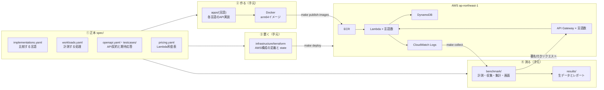
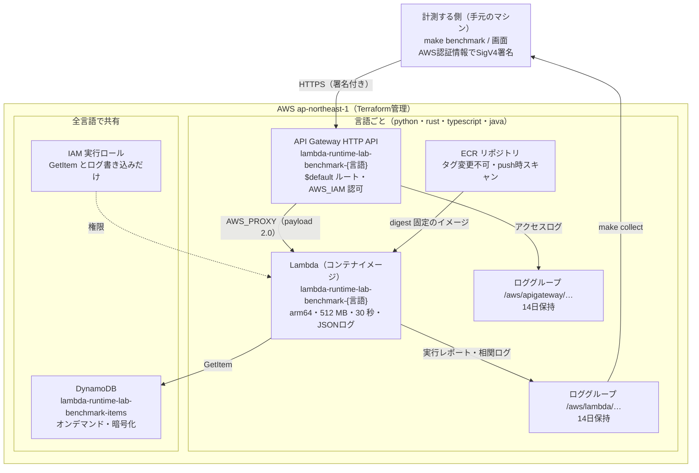
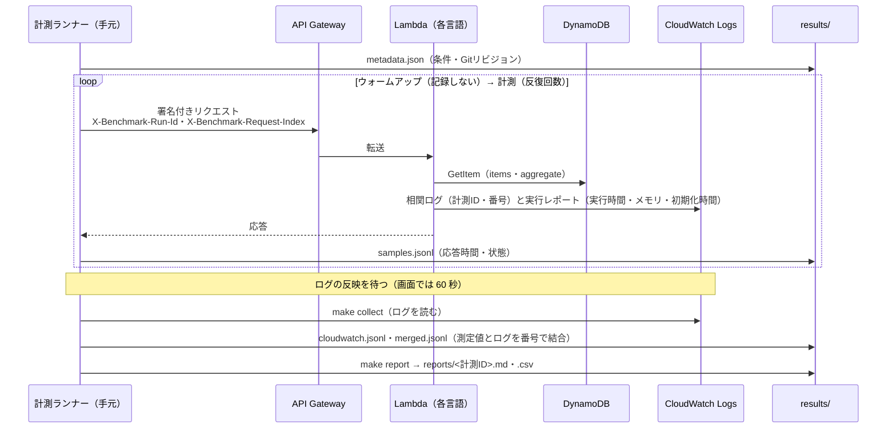
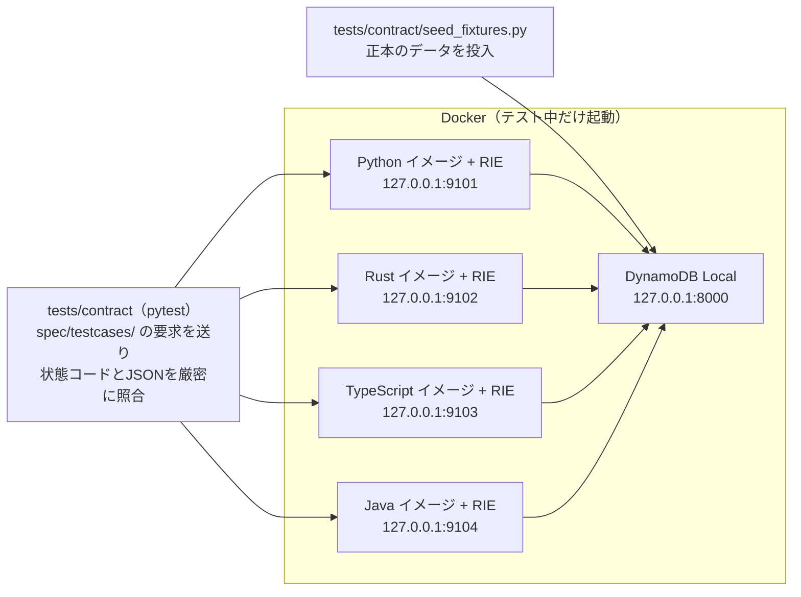
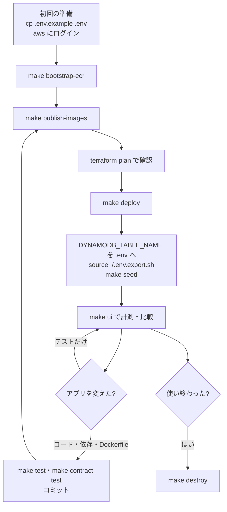

# 全体構成と操作の地図

対象: このリポジトリで開発・ビルド・デプロイ・計測・片付けをする人。
「どの資材が何をしていて、どのコマンドを実行すると、どこに何が起きるか」をまとめます。
画面の使い方は [画面の操作ガイド](09_画面の操作ガイド.md)、デプロイの詳しい手順は [AWSデプロイ手順](06_AWSデプロイ手順.md) を参照してください。

## 1. 全体像

| 層 | 責務 | 主な資材 |
| --- | --- | --- |
| 正本 | 何を比べるか（言語・処理・契約・料金）を一か所で決める | `spec/` |
| アプリ | 同じ API 契約を各言語で自然に実装する | `apps/python`・`apps/rust`・`apps/typescript`・`apps/java` |
| 成果物 | 全言語を同じ OS ベース（AL2023 OS-only）・arm64 のコンテナにする | 各 `Dockerfile`、`scripts/build-images.sh` |
| インフラ | 全言語を同じ設定の Lambda として AWS に置く | `infrastructure/terraform/` |
| 計測 | 同じリクエストを全言語へ送り、Lambda のログと結び付けて集計する | `benchmark/` |
| 確認 | 全言語の応答が正本と一致することを、デプロイ前に手元で確かめる | `tests/contract/`、`scripts/run-contract-test.sh` |
| 自動化 | 上記の入口をそろえる | `Makefile`、`scripts/`、`.github/workflows/` |

## 2. AWS の構成

言語ごとに同じ組（ECR・Lambda・HTTP API・ロググループ）を作り、DynamoDB と実行ロールは全言語で共有します。
言語の一覧は `spec/implementations.yaml` から Terraform が読むため、言語を足すとこの組が増えます。

| リソース | 数 | 定義 | 名前 | 補足 |
| --- | ---: | --- | --- | --- |
| ECR リポジトリと取得ポリシー | 言語数 | `ecr.tf` | `lambda-runtime-lab-benchmark-<言語>` | `make destroy` で中のイメージごと削除（`force_delete`） |
| Lambda 関数 | 言語数 | `lambda.tf` | 同上 | メモリ・タイムアウト・アーキテクチャ・ログ設定は全言語共通（`locals.tf`） |
| HTTP API・統合・ルート・ステージ・呼び出し権限 | 各言語数 | `apigateway.tf` | 同上 | 匿名アクセス不可（AWS_IAM） |
| ロググループ | 言語数 × 2 | `logs.tf` | `/aws/lambda/…`・`/aws/apigateway/…` | 保持14日。過去の計測を再収集できるのは14日以内 |
| DynamoDB テーブル | 1 | `dynamodb.tf` | `lambda-runtime-lab-benchmark-items` | `make seed` で約100件の決定的なデータを入れる |
| IAM 実行ロールとポリシー | 1 + 1 | `iam.tf` | `lambda-runtime-lab-benchmark-lambda-execution` | DynamoDB の GetItem とログ書き込みだけ |

名前の `benchmark` は環境名（Terraform の `environment`）です。`make` 経由の操作は既定で `benchmark` を渡します。
Terraform を直接実行するときに `-var=environment=benchmark` を付け忘れると、既定の `dev` として **全リソースを作り直す計画** になります。

Terraform の state（AWS 上の実リソースとの対応表）は、手元の `infrastructure/terraform/terraform.tfstate` だけにあります。消すと Terraform が既存のリソースを管理できなくなります。

## 3. 手元の資材

### ディレクトリ

| 場所 | 中身 | 主に使うコマンド |
| --- | --- | --- |
| `spec/implementations.yaml` | 比較する言語の一覧（キー・表示名・ディレクトリ・イメージに入らないテストのパス） | 全コマンドが読む |
| `spec/workloads.yaml` | 計測する処理（メソッド・パス・本文・回数・対応言語） | `make benchmark`、画面 |
| `spec/openapi.yaml`・`spec/testcases/` | API 契約と、正本の要求・期待応答 | 各言語のテスト、`make contract-test` |
| `spec/pricing.yaml` | Lambda 料金表（更新日・出典） | レポート、画面の料金 |
| `apps/<言語>/` | 各言語の API 実装・テスト・`Dockerfile` | `make test-<言語>`、`make build` |
| `benchmark/` | 計測ランナー、ログ収集、集計、レポート、画面（Python） | `make benchmark`・`collect`・`report`・`ui` |
| `tests/contract/` | 全言語の応答を正本と照合するテスト | `make contract-test` |
| `scripts/` | ビルド・公開・ECR作成・Contract Test・一括計測などの処理 | `make` から呼ばれる |
| `infrastructure/terraform/` | AWS 構成の定義 | `make deploy`・`destroy` |
| `results/raw/<計測ID>/` | 計測の生データ（条件・測定値・ログ・結合結果） | 計測で増える |
| `results/reports/<計測ID>.md`・`.csv` | レポート | `make report` |
| `docs/` | 要件・仕様・手順書・この資料 | — |
| `.github/workflows/` | CI（`ci.yml`）と手動の AWS 計測（`benchmark.yml`） | GitHub |

### Git で管理しないファイル

自動で作られるか、環境ごとに違うため Git に入れません。消してよいかを確認してから扱ってください。

| ファイル | 作るもの | 内容 | 消すと |
| --- | --- | --- | --- |
| `.env` | 利用者（`cp .env.example .env`） | リージョン・環境名・テーブル名など | `source ./.env.export.sh` と `make seed` で値を手で渡す必要がある |
| `.env.local` | 利用者（`cp .env.local.example .env.local`） | ローカル検証向けの値 | ローカルの手動検証で値を手で渡す必要がある |
| `infrastructure/terraform/images.auto.tfvars.json` | `make publish-images` | 各言語の Lambda に使う digest 固定のイメージ URI | `make deploy` が止まる（先に `make publish-images`） |
| `infrastructure/terraform/terraform.tfstate` | `make bootstrap-ecr`・`make deploy` | AWS 実リソースとの対応 | **AWS 上のリソースを管理できなくなる。消さない** |
| `results/raw/`・`results/reports/` | 計測・レポート作成 | 計測結果 | 画面の履歴から消える（`scripts/clean-results.sh` で選んで削除できる） |
| `apps/typescript/node_modules`・`apps/rust/target` など | 各言語のビルド | 依存とビルド成果物 | 次のビルドで作り直される |

### 正本を読む処理

正本を変えると、次の処理の対象が自動で変わります。言語ごとの値を各所に書き足す必要はありません。

| 正本 | 読む処理 | 変えると |
| --- | --- | --- |
| `implementations.yaml` | Terraform（`locals.tf`）、ビルド・公開スクリプト、計測、画面、Contract Test、デプロイ版の照合 | 言語が増減する。増やしたら `make bootstrap-ecr` → `make publish-images` → `make deploy` |
| `workloads.yaml` | 計測ランナー、画面の選択肢、料金の見込み | 計測できる処理が増減する |
| `openapi.yaml`・`testcases/` | 各言語の単体テスト、Contract Test | 全言語の実装を合わせる必要がある |
| `pricing.yaml` | レポートと画面の料金 | 料金が変わる。画面は過去の計測も新しい料金表で表示し、作成済みのレポートは `make report` で作り直すまで変わらない |

## 4. 操作の地図（コマンドごとに何が起きるか）

「AWS 書き込み」がある操作は料金が発生するか、AWS 上の状態を変えます。

### 品質確認（AWS に接続しない）

| コマンド | すること | 読む | 書く | 前提 |
| --- | --- | --- | --- | --- |
| `make format` | 全言語・Terraform を整形する | ソース | ソース（書き換える） | uv・cargo・npm・terraform |
| `make format-check` | 整形済みか確かめる（書き換えない） | ソース | なし | 同上 |
| `make lint` | `format-check` の後に静的解析（警告も失敗） | ソース | なし | 同上 + Java は Maven かDocker |
| `make test` | 全言語・計測ツール・契約ハーネスの単体テスト | ソース・`spec/testcases/` | なし | 同上 |
| `make test-python` など | 1言語だけテストする（`-rust`・`-typescript`・`-java`・`-benchmark`・`-contract-harness`） | 同上 | なし | 同上 |
| `make contract-test` | DynamoDB Local と全言語のイメージを起動し、応答を正本と照合する | イメージ・`spec/testcases/` | 一時コンテナ（終了時に削除） | Docker。イメージがなければその言語だけビルドする |
| `make terraform-validate` | Terraform の書式・構文・参照を確かめる | `infrastructure/terraform/` | `.terraform/`（初期化） | terraform |

### ビルド（AWS に接続しない）

| コマンド | すること | 書く |
| --- | --- | --- |
| `make build` | 共通ベースの digest を一度だけ解決し、全言語の arm64 イメージを作る | ローカルイメージ `lambda-runtime-lab-<言語>:local`、`results/raw/image-build-<日時>/<言語>-build.json` |
| `make build IMPLEMENTATIONS="python rust"` | 指定した言語だけ作る | 同上 |
| `make build-python`・`make build-rust` | 1言語だけ作る | 同上 |

### AWS の構築と更新

| コマンド | すること | AWS 書き込み | 前提 |
| --- | --- | --- | --- |
| `make bootstrap-ecr` | ECR リポジトリと取得ポリシーだけを作る（Lambda はまだ作らない） | あり | 初回と言語の追加時 |
| `make publish-images` | 全言語をビルドして ECR へ push し、digest 固定の URI を `images.auto.tfvars.json` に書く。**Lambda は変わらない** | あり（ECR） | ECR があること |
| `terraform -chdir=infrastructure/terraform plan -var=aws_region=$AWS_REGION -var=environment=$ENVIRONMENT` | 変更予定を表示する | なし | 認証済み |
| `make deploy` | Terraform apply。Lambda を新しいイメージへ切り替え、周辺リソースを作成・更新する | あり | `images.auto.tfvars.json` があること |
| `make destroy` | Terraform 管理の全リソースを削除する（ECR のイメージと DynamoDB のデータも消える） | あり（削除） | 必要な計測結果を手元に保存済み |

イメージのタグは `benchmark-<UTC日時>-g<コミット>` です。イメージの元になるファイルに未コミットの変更があると末尾に `-dirty` が付きます。
計測前の確認はこのタグでデプロイ済みの版を読み、デプロイ後にアプリのコード・依存定義・`Dockerfile` が変わっていれば計測を止めます（テストだけの変更では止めません）。

### データと計測

| コマンド | すること | AWS 書き込み | 書く（手元） |
| --- | --- | --- | --- |
| `make seed` | DynamoDB に決定的なテストデータ（約100件）を入れる。何度実行しても同じ内容 | あり（DynamoDB） | なし |
| `WORKLOAD=health make benchmark` | 全言語へ同じワークロードを送り、測定値を保存する。`TARGET=python,rust` で言語を絞る | あり（呼び出し料金） | `results/raw/<計測ID>/metadata.json`・`samples.jsonl` |
| `RUN_ID=<計測ID> make collect` | CloudWatch Logs から Lambda の実行レポートを読み、測定値と結び付ける | なし（読み取り） | `cloudwatch.jsonl`・`merged.jsonl` |
| `RUN_ID=<計測ID> make report` | 保存済みの測定値からレポートを作る | なし | `results/reports/<計測ID>.md`・`.csv` |
| `make ui` | 画面を起動する。画面からの計測は benchmark → 60 秒待ち → collect → report を自動で行う | 計測時のみ | 同上 |
| `make benchmark-matrix` | メモリ 256・512・1024 MB × 全ワークロードを順に計測する。**メモリごとに Lambda の設定を変える** | あり（Lambda 設定の変更と呼び出し） | 計測ごとの結果 |

`make benchmark` には `ARCHITECTURE` と `LAMBDA_MEMORY_MB`（`.env` の値）が必要です。Lambda の実設定と異なると比較が無効になるため、`aws lambda get-function-configuration` で全言語の値を確認してから設定します。
`make benchmark-matrix` の終了後、Lambda のメモリは最後の値（1024 MB）のままです。元に戻すには `make deploy` を実行します。ログの反映待ちは 10 秒（`LOG_PROPAGATION_WAIT_SECONDS` で変更）のため、「ログと未結合」が出た計測は後から `RUN_ID=<計測ID> make collect` で再収集します。

### make を経由しないスクリプト

| スクリプト | すること |
| --- | --- |
| `RUN_ID=<計測ID> TAG=<タグ> bash scripts/collect-image-metrics.sh` | イメージの容量・レイヤー・ECR の digest を `results/raw/<計測ID>/image-metrics.json` に記録する（レポートと画面に「コンテナイメージの情報」として出る） |
| `bash scripts/clean-results.sh --run-id <計測ID>`（`--all`・`--dry-run`・`--yes`） | 計測結果を削除する |
| `source ./.env.export.sh`（`--local`） | `.env`（`.env.local`）の値を今のシェルに読み込む。`source` で実行する |

多くのスクリプトは `--dry-run` で、実行せずに予定のコマンドだけを表示できます。

## 5. 1回の計測で起きること

- 計測とログは、ヘッダーで送った計測 ID とリクエスト番号で結び付けます。結び付けられない件数が画面とレポートの「ログと未結合（Unclassified）」です。
- コールドスタートかどうかは、実行レポートに初期化時間があるかで判定します。ウォームアップの結果は記録しないため、ウォームアップ中に起きたコールドスタートは結果に入りません。
- 料金は課金対象時間・メモリ・料金表から計算します（Free Tier・API Gateway・DynamoDB は含みません）。

## 6. 手元での動作確認（Contract Test）の構成

`make contract-test` は、デプロイするのと同じイメージを手元で起動し、全言語の応答が正本と一致するかを確かめます。AWS には接続しません。

- RIE（Lambda Runtime Interface Emulator）は、Lambda の呼び出しを手元で再現する仕組みです。ポートは 9101 から言語一覧の順に割り当てます。
- 自分で起動したコンテナだけを、終了時に削除します。
- `PYTHON_API_URL` などを全言語分指定すると、起動を行わず、その接続先だけを検証します。

## 7. CI

| ワークフロー | いつ動くか | すること | AWS |
| --- | --- | --- | --- |
| `ci.yml` | push・プルリクエスト | Python・計測ツール・契約ハーネス・Rust・TypeScript・Java の書式とテスト、arm64 ランナーでのイメージビルドと Contract Test、Terraform validate | 使わない |
| `benchmark.yml` | 手動（workflow_dispatch） | 指定した digest のイメージでデプロイ → seed → 計測 → 収集 → レポート → 成果物の保存 → （既定で）削除 | 使う（OIDC でロールを引き受ける） |

`benchmark.yml` の Terraform state は CI の中だけで作られます。手元で作った環境と同じアカウント・環境名で実行すると、同じ名前のリソースが衝突します。

## 8. よくある流れ

## 9. こうしたいときは

| したいこと | 手順 |
| --- | --- |
| 初めて AWS に環境を作る | `cp .env.example .env` → AWS にログイン → `make bootstrap-ecr` → `make publish-images` → `plan` で確認 → `make deploy` → テーブル名を `.env` へ → `source ./.env.export.sh` → `make seed` |
| 計測して比べる | `make ui` →「＋ 新しく計測する」（詳しくは [画面の操作ガイド](09_画面の操作ガイド.md)） |
| ターミナルだけで計測する | `source ./.env.export.sh` → `WORKLOAD=health make benchmark` → 表示された計測 ID で `make collect` → `make report` |
| アプリの変更を AWS に反映する | `make test` → `make contract-test` → コミット → `make publish-images` → `plan` → `make deploy` |
| 変更が正しいかを AWS なしで確かめる | `make lint` → `make test` → `make contract-test` |
| デプロイ済みの版を確かめる | `aws lambda get-function --function-name lambda-runtime-lab-benchmark-<言語> --query 'Code.ImageUri' --output text`、または画面の「新しく計測する」で警告が出ないこと |
| AWS と定義の差分を確かめる | `terraform -chdir=infrastructure/terraform plan -var=aws_region=$AWS_REGION -var=environment=$ENVIRONMENT` が `No changes` |
| 前のイメージに戻す | 以前の `images.auto.tfvars.json`（または各 Lambda の `Code.ImageUri`）に戻し、`plan` → `make deploy` |
| メモリを変えて比べる | `make benchmark-matrix`（全組み合わせ）。1つの値だけなら `terraform -chdir=infrastructure/terraform apply -var=aws_region=$AWS_REGION -var=environment=$ENVIRONMENT -var=lambda_memory_mb=<値>` を実行し、`.env` の `LAMBDA_MEMORY_MB` も合わせる（次の `make deploy` で既定の 512 MB に戻る） |
| 言語を増やす | [ワークロードと言語の追加手順](08_ワークロードと言語の追加手順.md)。要点は `apps/<言語>` と `spec/implementations.yaml` に追加 → `make contract-test` → `make bootstrap-ecr` → `make publish-images` → `make deploy` |
| 計測する処理を増やす | 同じく 08。要点は `spec/workloads.yaml`（新しい API なら `openapi.yaml`・`testcases/` と各言語の実装も） |
| 料金表を更新する | `spec/pricing.yaml` の料金・更新日・出典を公式の料金ページに合わせる |
| レポートの読み方を知る | [ベンチマークレポート利用ガイド](07_BENCHMARK_REPORT_GUIDE.md) |
| 計測結果を消す | `bash scripts/clean-results.sh --run-id <計測ID> --dry-run` で確認してから `--dry-run` を外す |
| 料金を止める | `make destroy`（ECR のイメージと DynamoDB のデータも消える。必要な結果は `results/` に残る） |

## 10. 注意点

| 項目 | 内容 |
| --- | --- |
| 料金 | `make benchmark`・`make ui` からの計測・`make benchmark-matrix` は Lambda などの料金が発生する。待機中の Lambda・API Gateway・DynamoDB（オンデマンド）は使った分だけ、ECR はイメージの保存量に応じて課金される |
| 環境名 | Terraform を直接実行するときは `-var=environment=benchmark` を必ず付ける（付けないと既定の `dev` で全リソースを作り直す計画になる） |
| state | `terraform.tfstate` は手元にしかない。消さない・別のマシンで同時に操作しない |
| ログの保持 | CloudWatch Logs は14日で消える。`make collect` は計測から14日以内に行う |
| 認証情報 | `.env` を含め、アクセスキーをファイルに書かない。`AWS_PROFILE` などで切り替える |
| 画面 | `127.0.0.1` だけで待ち受け、別サイトからの操作要求は拒否する。デプロイ・seed・削除は画面からできない |
